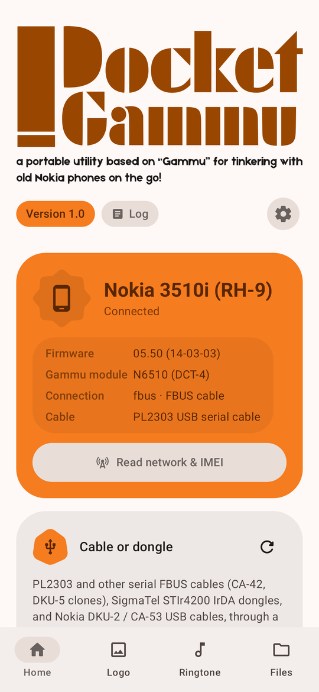
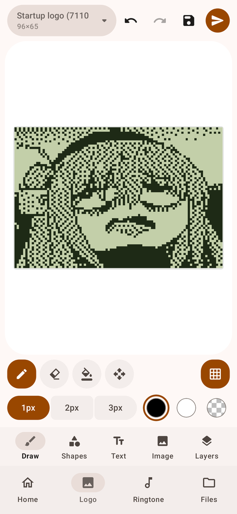
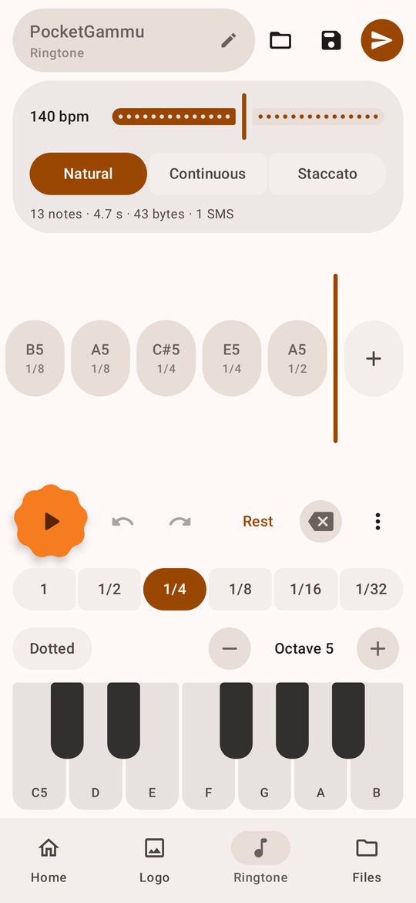
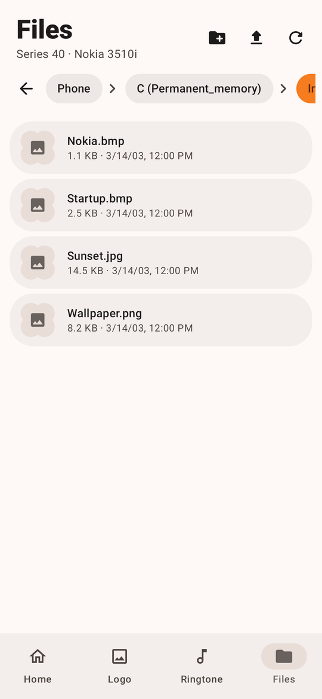

  <picture>
    <source media="(prefers-color-scheme: dark)" srcset="docs/logo-white.svg">
    
  </picture>

  
  
  
  

<b>A portable utility based on "Gammu" (Gammu All Mobile Management Utilities) for tinkering with old Nokia phones on the go!</b>

PocketGammu is an experimental / proof-of-concept Android app. Plug an old Nokia into your Android phone through a USB-to-serial converter and a Nokia serial cable or an infrared dongle, then make logos, ringtones and
picture messages and send them to it, or manage the files on it.

## Features

### Connecting

- Cables: FBUS (DAU-9P and TTL), DKU-5 / CA-42, PL2303-based CA-42 clones, DLR-3P, and
  Nokia USB (DKU-2, CA-53 or the phone's own USB port)
- USB serial chips: PL2303, FTDI, CH340, CP210x and USB CDC
- Infrared through a SigmaTel STIr4200 IrDA dongle, as full IrDA (6210, 6310i, 6510,
  8210, 8310, Series 40) or raw infrared FBUS (6110, 6130, 6150, 6190)
- Detects the phone model by itself, or lets you pick the phone family
- Shows model, firmware, network and IMEI
- Detailed connection log you can copy or share

### Logo editor

- Operator logos (72×14 and 78×21), caller group logos, startup logos (84×48 and 96×65)
  and 72×28 picture messages with up to 120 characters of text
- Pencil, eraser, fill, move, shapes, 1–3 px brushes, layers, grid, zoom, undo and redo
- Text with built-in fonts or your own .ttf / .otf, with outline, width, letter spacing
  and inverted options
- Image import with move, pinch to scale, twist to rotate, stretch, and five dithering modes
- Save any logo as a BMP file
- Send to the phone by cable, or as a Smart Messaging SMS from your Android phone

### Ringtone editor

- Compose on a note track or with an on-screen keyboard, with a soft sine-wave preview
- Import RTTTL text, MIDI and NRT files; export RTTTL
- Send by cable or by SMS

### File manager (Series 40)

- Browse, download, upload and delete files, and create folders

### Look and feel

- Material 3 Expressive design with light and dark modes
- Material You adaptive color scheme + other cool built-in themes!

## Tested phones

Tested by the developer: Nokia 6150 (infrared), 6510, 3510i and 3200. Other phones in the
same families should work but haven't been tried yet. Reports are welcome in Issues.

## Limitations

- **Limited dongle support.** The only infrared dongle that works is the SigmaTel STIr4200.
  KingSun KS-959 dongles aren't supported, and newer SigmaTel chips (STIr4210, 4220,
  4116) need a firmware upload that isn't implemented.
- **Nokia DCT-3, DCT-4 and Series 40 only.** There are no AT-command or M-Bus connections,
  so other brands and AT-only phones won't work.
- **No contacts, messages, calendar or backups.** The app focuses on logos, ringtones,
  picture messages and files.
- **The file manager needs a Series 40 phone.** Older phones have no file system to browse.
- **Picture messages by cable** only work on the older N6110 family (3310, 3330, 3410,
  6150, 8210) and haven't been tested on a real phone yet. Send them by SMS to other phones.
- **SMS sending** needs a SIM in your Android phone, costs normal text rates, and a large
  logo or picture message can take several texts.
- Needs Android 8.0 or newer with USB OTG support.
- It's experimental: writing to an old phone is at your own risk.

## Download

Get the APK from [Releases](../../releases) and install it on your phone (allow installs from
unknown sources when asked). PocketGammu isn't on the Play Store.

## Source code

The full source code for each version is attached to its release as a .zip. Open it in
Android Studio, or build it with `./gradlew :app:assembleRelease`. DEVELOPMENT.md inside
the zip covers the module layout, tests and conventions.

## Credits and license

Conceptualized by Noki-min ([@waifusonoldnokias](https://github.com/waifusonoldnokias)) with
major assistance from Claude Opus.

The phone engine is a Java port of [Gammu](https://github.com/gammu/gammu) carried over from
the developer's earlier GammuDroid project. USB serial support uses
[usb-serial-for-android](https://github.com/mik3y/usb-serial-for-android).

PocketGammu is free software under the GNU General Public License version 2, the same as
Gammu. See [LICENSE](LICENSE).
